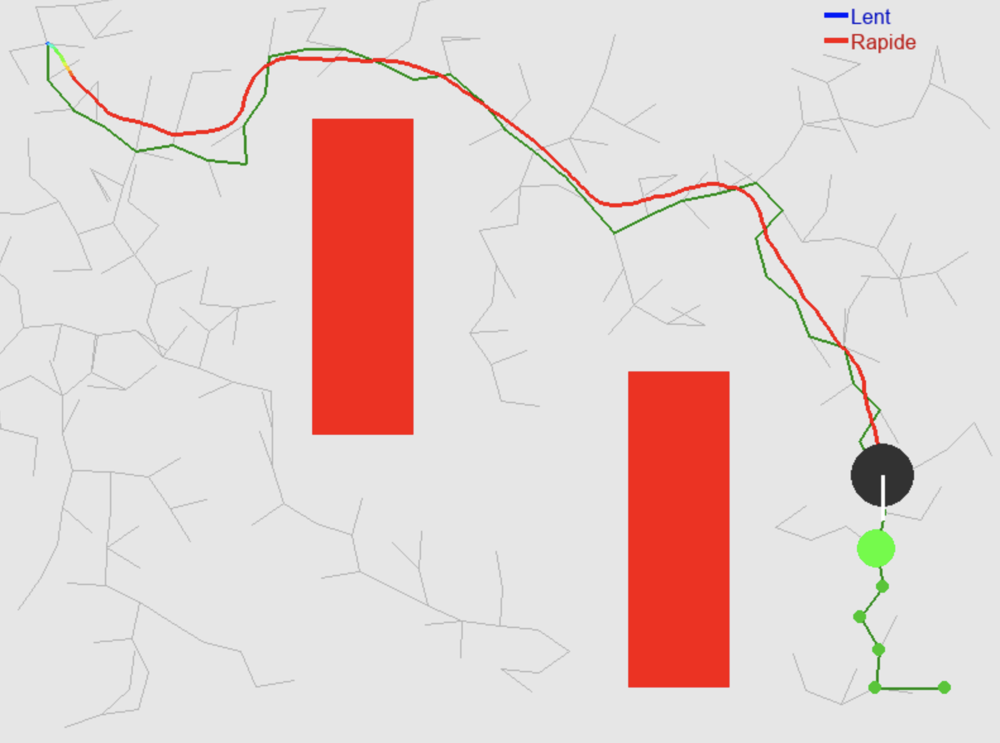
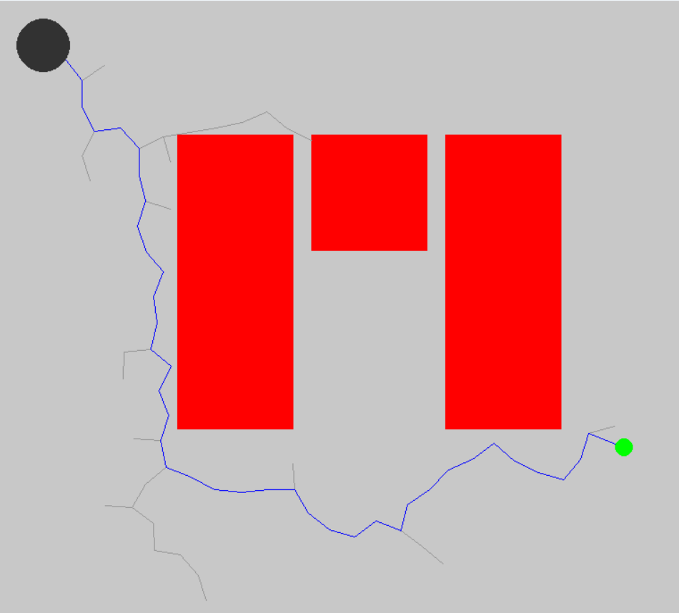
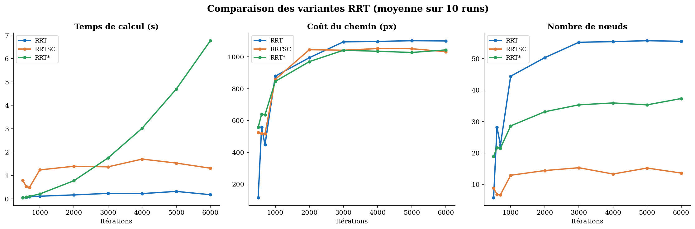
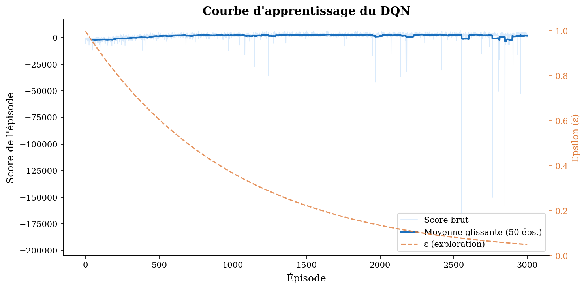
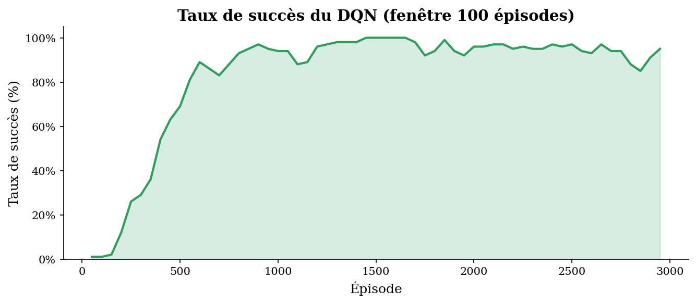
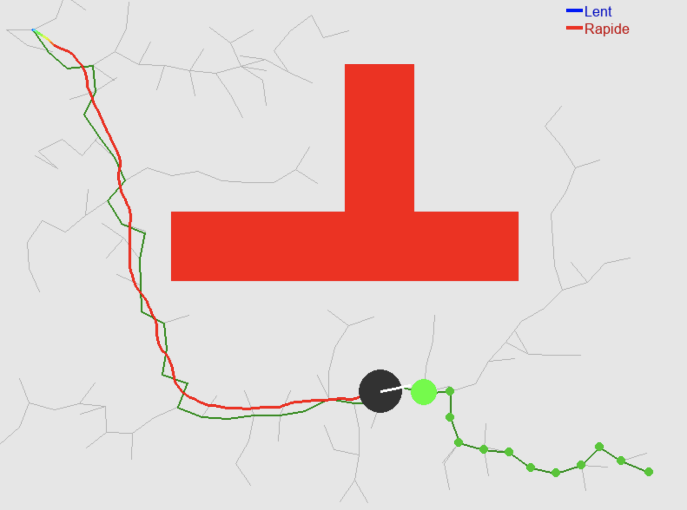

<div align="center">

# Navigation autonome en environnement incertain

**Planification de trajectoire (RRT, RRT\*, RRTSC) + apprentissage par renforcement profond (Double DQN)**

*Projet de recherche — Master 1 Informatique, Université de Lorraine (2025-2026)*

[](https://www.python.org/)
[](https://pytorch.org/)
[](https://www.pygame.org/)
[](LICENSE)

[📄 Lire le rapport (PDF)](docs/rapport_navigation_autonome.pdf) · [🇬🇧 English summary](#-english-summary)



*Le robot (cercle noir), piloté par le réseau DQN, suit le chemin planifié par le RRT (vert) en gérant lui-même sa vitesse et ses virages. En gris : l'arbre d'exploration du RRT.*

</div>

---

## Problématique

> *Comment exploiter une trajectoire générée par un algorithme de planification afin de guider un algorithme d'apprentissage par renforcement et améliorer l'apprentissage de la navigation d'un véhicule dans un environnement incertain ?*

La navigation d'un robot mobile se découpe classiquement en deux niveaux :

1. **Planification** : un algorithme calcule un chemin sans collision dans la carte → ici **RRT** et ses variantes.
2. **Contrôle** : un contrôleur exécute ce chemin en tenant compte de la dynamique réelle du robot → ici un agent **Deep Q-Learning** entraîné par essais-erreurs.

Apprendre à naviguer « from scratch » coûte très cher en exploration. Notre approche : **le RRT sert de GPS** (il donne des waypoints) et **le DQN sert de pilote** (il apprend à les suivre en évitant les obstacles grâce à des capteurs LIDAR).

## Contributions

- **Simulateur 2D** (Pygame) d'un robot circulaire à cinématique simple (accélérer, freiner, tourner), avec obstacles rectangulaires.
- **Trois planificateurs** implémentés from scratch avec **contrainte d'angle** maximal entre deux branches (virages réalisables par le véhicule) :
  - `RRT` : algorithme classique de LaValle ;
  - `RRT*` : choix du meilleur parent et recâblage de l'arbre (Karaman & Frazzoli) ;
  - **`RRTSC` (RRT + ShortCut)** : **variante originale** proposée dans ce projet, qui ajoute au RRT une phase de post-traitement par raccourcis respectant la contrainte d'angle.
- **Benchmark** des trois planificateurs : temps de calcul, coût du chemin, nombre de nœuds.
- **Agent Double DQN** (PyTorch) guidé par les waypoints RRT, avec :
  - 5 capteurs **LIDAR** simulés (−60°, −30°, 0°, +30°, +60°) ;
  - **gonflement des obstacles** pour que le RRT laisse de la place au robot ;
  - **experience replay** (mémoire de 20 000 transitions) ;
  - une **mécanique de « traumatisme »** : chaque collision est réinjectée 10× dans la mémoire pour que ces événements rares soient mieux appris ;
  - entraînement sur **5 cartes** avec départ/arrivée aléatoires à chaque épisode.

## Résultats

### Planification : RRT vs RRTSC vs RRT\*

<p align="center"><br><em>Arbre RRT (gris) et chemin trouvé (bleu) entre le robot et l'objectif (vert).</em></p>

<p align="center"></p>

| | Temps de calcul | Coût du chemin | Nœuds dans le chemin (3000 it.) |
|---|---|---|---|
| **RRT** | le plus rapide (< 0,4 s) | le plus élevé | ~55 |
| **RRT\*** | croît linéairement (~7 s à 6000 it.) | le plus faible (optimalité asymptotique) | ~35 |
| **RRTSC** *(notre variante)* | stable (~1,5 s) | proche du RRT\* | **~15 (−70 % vs RRT)** |

➡️ **RRTSC offre le meilleur compromis** : quasi la rapidité du RRT, un coût proche du RRT\*, et des chemins beaucoup plus épurés, donc des waypoints plus clairs pour guider l'apprentissage.

### Apprentissage : Double DQN guidé par RRT

<p align="center">
  
  
</p>

- Après 3 000 épisodes, le robot atteint **73 % à 91 % de réussite selon la carte d'entraînement**, et parvient à naviguer sur des cartes **jamais vues** pendant l'apprentissage (démo `demo_dqn.py`).
- Il a appris à rouler à pleine vitesse la majorité du temps tout en contournant les obstacles.

<p align="center"></p>

Le détail de l'évolution du modèle (3 versions successives, calibrage des récompenses, analyse des échecs) est dans le [rapport](docs/rapport_navigation_autonome.pdf).

## Structure du dépôt

```
.
├── src/
│   ├── rrt.py               # RRT classique avec contrainte d'angle
│   ├── rrt_star.py          # RRT* (meilleur parent + recâblage)
│   ├── rrt_sc.py            # RRTSC : RRT + phase de raccourcis (contribution originale)
│   ├── demo_rrt.py          # visualisation interactive d'un planificateur
│   ├── benchmark_rrt.py     # comparaison temps / coût / nœuds des 3 planificateurs
│   ├── environnement.py     # environnement RL : robot, LIDAR, récompenses
│   ├── entrainement_dqn.py  # entraînement du Double DQN guidé par RRT
│   ├── demo_dqn.py          # démo du modèle entraîné sur une carte inédite
│   └── generer_graphes.py   # génération des figures à partir des CSV
├── models/
│   └── dqn_meilleur_modele.pth   # poids du meilleur modèle DQN (13 → 128 → 128 → 5)
├── results/
│   ├── data/                # CSV d'entraînement et du benchmark
│   └── figures/             # figures générées
└── docs/
    ├── rapport_navigation_autonome.pdf
    └── images/
```

## Installation

```bash
git clone https://github.com/eyub-celebioglu/navigation-autonome-rrt-dqn.git
cd navigation-autonome-rrt-dqn
python3 -m venv venv
source venv/bin/activate        # Windows : venv\Scripts\activate
pip install -r requirements.txt
```

## Utilisation

Toutes les commandes se lancent depuis la racine du dépôt.

```bash
# 1. Visualiser un planificateur (choix RRT / RRTSC / RRT*, itérations, longueur des branches, angle)
python src/demo_rrt.py

# 2. Voir le robot DQN pré-entraîné suivre un chemin RRT sur une carte inédite
python src/demo_dqn.py

# 3. Comparer les trois planificateurs (écrit results/data/benchmark_rrt.csv)
python src/benchmark_rrt.py

# 4. Ré-entraîner le DQN (3000 épisodes, long ! écrase le modèle et le CSV d'entraînement)
python src/entrainement_dqn.py

# 5. Régénérer les figures dans results/figures/
python src/generer_graphes.py
```

> Dans `demo_rrt.py`, le robot peut aussi être piloté au clavier : `Z` avancer, `Q` / `D` tourner.

## Détails techniques du DQN

| Élément | Choix |
|---|---|
| Entrée (13) | position (x, y), cos/sin de l'orientation, vitesse, distance au waypoint, cos/sin de l'angle vers le waypoint, 5 LIDAR, le tout normalisé |
| Réseau | MLP 13 → 128 → 128 → 5, activations ReLU |
| Actions (5) | accélérer, freiner, tourner à gauche, tourner à droite, ne rien faire |
| Algorithme | Double DQN, réseau cible mis à jour tous les 50 épisodes |
| Optimisation | Adam (lr = 0,001), SmoothL1Loss, gradient clipping à 1,0, γ = 0,99 |
| Exploration | ε-greedy, 1,0 → 0,05 (décroissance 0,999 par épisode) |
| Récompenses | +100 par waypoint, +200 à l'arrivée, −200 collision, −0,1 par pas, bonus d'approche et d'alignement, pénalité de proximité aux murs (LIDAR) |

## Pistes d'amélioration

- Entraîner sur des chemins issus des **trois planificateurs** (et pas seulement du RRT) pour un contrôleur plus générique.
- **Cartes générées aléatoirement** pour améliorer la généralisation.
- Ajouter du **bruit** dans la dynamique (dérive, capteurs imprécis) pour se rapprocher d'un environnement réellement incertain.
- Accélérer la recherche du plus proche voisin du RRT avec un **KD-tree** (O(log n) au lieu de O(n)).

## Auteurs

- **Eyub Celebioglu** — [@eyub-celebioglu](https://github.com/eyub-celebioglu)
- **Rahma Ouanennas**
- **Yoann Morau**

Projet encadré par **Olivier Buffet** dans le cadre de l'UE *Initiation à la recherche* du Master Informatique de l'Université de Lorraine. Merci à lui pour son accompagnement et ses conseils.

## Références

1. S. M. LaValle, *Rapidly-exploring Random Trees: A New Tool for Path Planning*, 1998.
2. J. J. Kuffner Jr., S. M. LaValle, *Randomized Kinodynamic Planning*, 2001.
3. S. Karaman, E. Frazzoli, *Incremental Sampling-based Algorithms for Optimal Motion Planning*, 2010.
4. M. Ghallab, D. Nau, P. Traverso, *Acting, Planning, and Learning*, 2016.
5. PyTorch, *Reinforcement Learning (DQN) Tutorial*.

---

## 🇬🇧 English summary

This project investigates **autonomous navigation of a mobile robot in an uncertain 2D environment** by combining **path planning** and **deep reinforcement learning**.

- Three planners are implemented from scratch with a maximum-turning-angle constraint: **RRT**, **RRT\*** and **RRTSC**, an original extension that adds a shortcut post-processing phase. RRTSC offers the best trade-off: near-RRT speed, near-RRT\* path cost and **~70% fewer waypoints** than RRT.
- A **Double DQN** agent (PyTorch) learns to follow RRT waypoints using **5 simulated LIDAR sensors**, experience replay, obstacle inflation and a "trauma" mechanism that replays collisions to learn from rare events.
- The trained controller reaches **73–91% success rates** depending on map complexity, and also navigates maps never seen during training.

The full report (in French) is available [here](docs/rapport_navigation_autonome.pdf).
